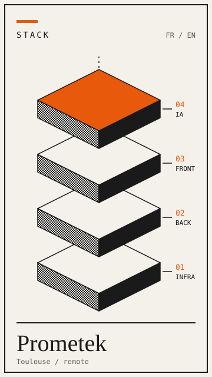
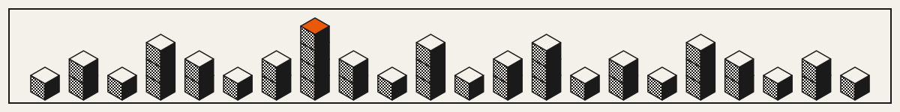

<table align="center">
  <td>
    
  </td>
  <td>
    
 
      <h3>Tech Lead Fullstack – Data & IA – FR/EN</h3>
      <a href="https://TON_SITE">Voir mon portfolio</a> ››
      <a href="mailto:TON_EMAIL">Me contacter</a> ››
      <a href="https://TON_LIEN_RDV">Réserver un appel</a>
    
  
    
 <strong>Backend</strong>

    <ul>
      <li><strong>Langages :</strong> Python, Rust</li>
      <li><strong>Frameworks :</strong> FastAPI, Pydantic</li>
      <li><strong>Bases de données :</strong> PostgreSQL</li>
      <li><strong>ORM & migrations :</strong> SQLAlchemy, Alembic</li>
      <li><strong>Tests :</strong> pytest</li>
    </ul>
    
 <strong>Frontend</strong>

    <ul>
      <li><strong>Frameworks :</strong> React, Next.js</li>
      <li><strong>Langages :</strong> TypeScript</li>
    </ul>
    
 <strong>IA</strong>

    <ul>
      <li><strong>Applications :</strong> LLM, agents, embeddings</li>
      <li><strong>Protocoles :</strong> MCP</li>
      <li><strong>Outils :</strong> Claude Code, pipelines multi-agents</li>
    </ul>
    
 <strong>Workflow</strong>

    <ul>
      <li><strong>DevOps & CI/CD :</strong> Git, GitHub, Docker</li>
      <li><strong>Architecture :</strong> ADR, specs, dossiers d'architecture</li>
      <li><strong>Réalisations :</strong> suivi de la qualité de l'eau (France 2030), monitoring de radiométrie, Warden</li>
    </ul> 
  </td>
</table>

  

